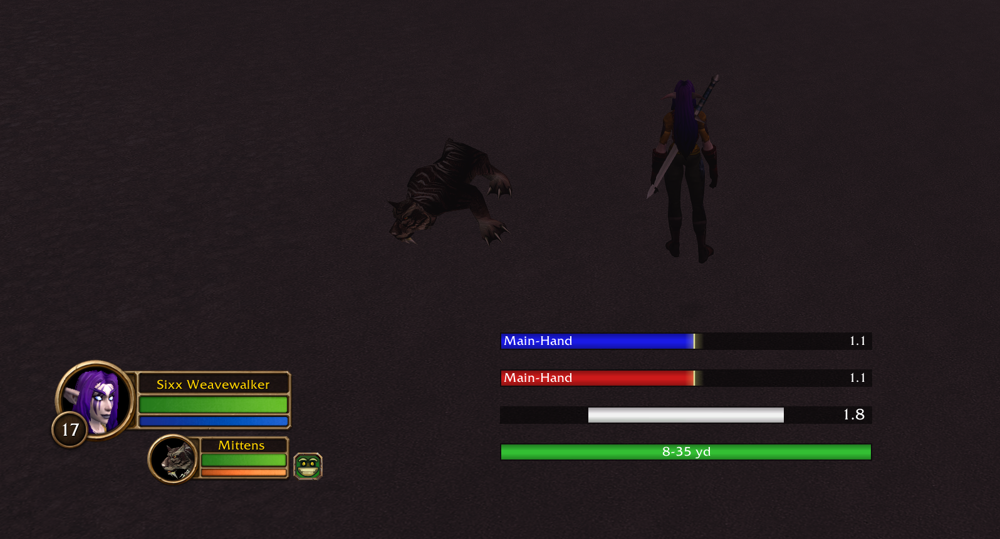
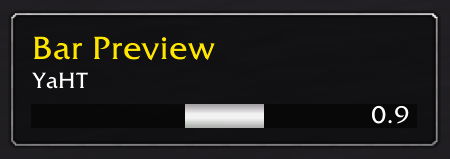
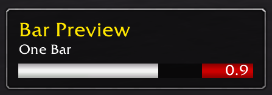
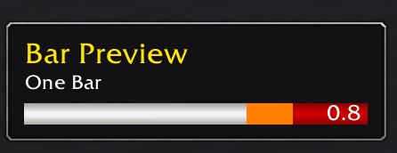
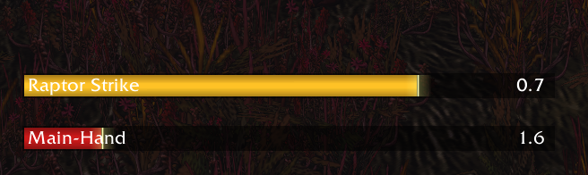
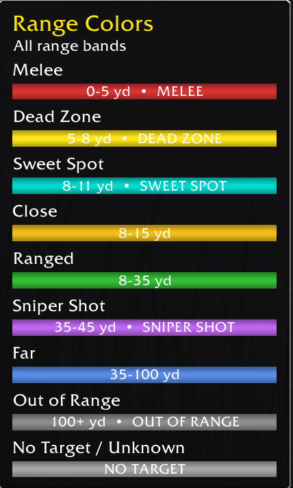
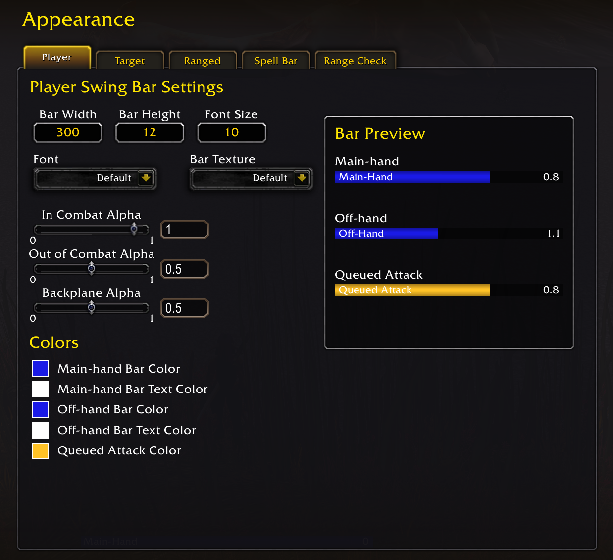

# WeaponSwingTimer SixxFix

Track melee swings, Hunter Auto Shot, and wand shots. Supported builds also include a Hunter spell cast bar and an optional target range display.

## Quick setup

1. Extract the ZIP for your WoW client into `Interface/AddOns`. The final path should be `Interface/AddOns/WeaponSwingTimer/WeaponSwingTimer.toc`.
2. Run `/reload` if the game is open, then type `/wst`.
3. Uncheck **Lock All Bars** and turn on **Preview Bars** to position enabled bars outside combat. Lock them and turn off preview when you're done.

Options vary by build and client. Updating the addon files keeps your saved profiles.

## Hunter: centered vs. YaHT / One Bar

Find **YaHT / One bar** under **Ranged Settings**. It's one toggle with two layouts:

| Layout | White: between shots | Red: Auto Shot cast |
| --- | --- | --- |
| **Centered** (toggle off) | Shrinks toward the middle. | Grows outward from the middle while casting. |
| **YaHT / One Bar** (toggle on) | Fills from left to right. | Shrinks at the right edge as the cast finishes. |

**White** is generally the time you can move. **Red** is when to stand still for Auto Shot. **Gray** marks a ranged timer reset after a melee swing or Feign Death in builds that support it.

### Orange: Auto Shot retry

With **Auto Shot delay timer** enabled, orange appears after a failed Auto Shot attempt. It counts down toward the middle in **Centered** mode or toward the red cast segment in **One Bar**. While orange is showing, the number combines the retry time and the Auto Shot cast time. Orange alone doesn't mean your next shot was delayed by the full retry window.

The separate **Hunter spell bar** shows supported cast-time shots such as Aimed Shot and Multi-Shot. In builds with **Preview Bars**, it's hidden outside combat except during preview.

## Other bars and settings

| Page | What to set up |
| --- | --- |
| **Melee Settings** | Player and target swings, off-hand display, fill direction, text, and opacity. The main-hand bar can highlight queued Heroic Strike, Cleave, Maul, or Raptor Strike. |
| **Range Check Settings** | Enable range bands, customize their labels, and hide the bar with no target or a dead target. Range bands are estimates and can vary by class and target. |
| **Appearance** | Set the font, size, texture, and colors for each bar. **Default** keeps the existing look. Extra fonts and textures can appear under **Shared Media** when available. |
| **Profiles** | Save and switch between layouts. |

On Forever, Auto Shot's normal range band follows your Hawk Eye rank. Enable **Show Sniper Shot range** in Range Check Settings to highlight targets within Sniper Shot reach and see extended Auto Shot range when the Sniper buff is active. Use `/wstrangedebug` to see which probes are answering.

## Troubleshooting

- **Bar missing?** Check that it's enabled and its opacity isn't zero. Try **Preview Bars** to locate it.
- **Range Check missing?** In supported builds, `/wstrangeshow` enables and recenters it, restores full opacity, and turns off target hiding. `/wstrangedebug` prints the active range checks.
- **Swing timing looks off?** Run `/wstswinglog start`, reproduce it, then run `/wstswinglog stop` and `/wstswinglog copy`. Starting a new capture replaces the old one.

Originally created by **LeftHandedGlove**. SixxFix is maintained by **WatchYourSixx**.
